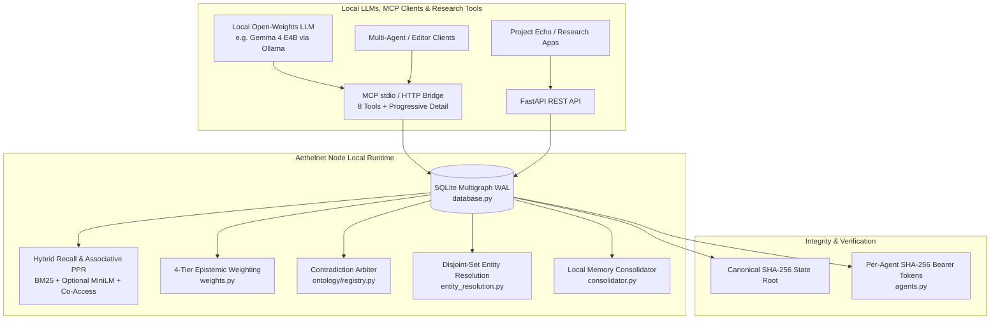

# Aethelnet Node: Local-First Epistemic Knowledge Graph & MCP Memory Server

[](https://fastapi.tiangolo.com)
[](LICENSE)
[](aethelnet_node/database.py)
[](aethelnet_node/mcp/mcp_protocol.py)
[](tests/)

**Aethelnet Node** is a local-first, privacy-preserving multigraph memory server and evidentiary reconciliation engine written in Python (`FastAPI` + `SQLite WAL`). It runs entirely on local hardware with zero cloud lock-in, exposing **8 Model Context Protocol (MCP) tools** and a REST API so small local Open-Weights models (e.g. `gemma4:e4b` via Ollama) and multi-agent workflows can store, retrieve, audit, and reconcile structured knowledge with explicit provenance and contradiction tracking.

---

## Why Local-First Epistemic Memory?

Standard RAG pipelines and cloud memory services flatten knowledge into unverified text chunks, silently overwrite conflicting claims, and leak sensitive documents to third-party APIs. **Aethelnet Node** takes a deterministic, data-minimizing approach:

- **100 % Local Storage (`SQLite WAL`)**: Single-file local database (`database.py`) with zero mandatory cloud dependencies.
- **Explicit Provenance & Attribution**: Every node and claim records immutable `created_at`, authoring agent (`created_by`), optional `model_id`, verbatim `evidence_quote`, and `source_doc_id`.
- **Contradictions as First-Class Data**: Conflicting assertions are flagged (`is_contested`) and evaluated via a 4-tier epistemic weighting engine (`weights.py`) and symmetric contradiction arbiter (`ontology/registry.py`) instead of silently vanishing.
- **Built for Small Local Models (Progressive Detail Density)**: Tool outputs (`mcp_protocol.py`) deliver full top-hit context without truncating critical facts while keeping lower-ranked neighbors compact — enabling compact 4B local models (e.g. `gemma4:e4b`, 6 GB RAM) to perform reliable multi-step recall and memory consolidation (`consolidator.py`) alongside `aethelnet-core`'s Kuramoto/LTC dynamics.
- **Deterministic Integrity Proofs**: Computes canonical off-chain `SHA-256` state roots over sorted nodes and edges for reproducible audit snapshots.

---

## Architecture Overview



---

## 8 Live MCP Tools (`aethelnet_node/mcp/mcp_protocol.py`)

Point any MCP client at the local stdio bridge (`python -m aethelnet_node.mcp.mcp_stdio_server`):

| MCP Tool | Purpose |
| :--- | :--- |
| `lgnn_query_graph` | Browse active concept nodes and graph summary up to requested `limit`. |
| `lgnn_read_node_content` | Read full node text, provenance (`created_at`, `created_by`, `model_id`), and directional edges (`--[rel]-->` / `<--[rel]--`, incl. `[CONTESTED]` & evidence). |
| `lgnn_write_concept` | Store or update a concept/invariant/evidence node with optional `task_id` and `skip_coaccess` scoping. |
| `lgnn_link_concepts` | Create directed edges with optional `evidence_quote`, `source_doc_id`, `is_contested`, and `skip_coaccess`. |
| `lgnn_search_concepts` | Focused lexical/semantic search with `node_type`, `created_by`, and `epistemic_tier` filters (no co-access noise). |
| `lgnn_topological_recovery` | Associative recovery via BM25 + optional MiniLM RRF + Personalized PageRank over task co-access edges with Progressive Detail Density. |
| `lgnn_mark_useful` | Reinforce helpful recall hits within a task boundary (`Hebbian co-access` with continuous exponential decay). |
| `lgnn_archive_concept` | Soft-archive outdated notes with optional `superseded_by` pointer while preserving full provenance history. |

### MCP Client Configuration

```json
{
  "command": "python3",
  "args": ["-m", "aethelnet_node.mcp.mcp_stdio_server"],
  "env": {
    "AETHELNET_API_URL": "http://127.0.0.1:8001/api/lgnn",
    "AETHELNET_AUTH_TOKEN": "<this-agent-token>"
  }
}
```

---

## Core Engine Components

### 1. 4-Tier Epistemic Weighting Engine (`weights.py`)

Every assertion edge $(u, v)$ carries a computed evidentiary weight $W \in [0.0, 1.0]$ based on source tier, verbatim completeness, and logarithmic multi-source corroboration:

$$ W(e) = \min\left(1.0, \; \text{BaseTier} \times \text{Completeness} \times \left(1.0 + 0.12 \times \log_2(N)\right)\right) $$

* **Tier 1 — Primary Archive / Axiom (`0.95`)**: Official primary records, peer-reviewed catalogs, verified invariants.
* **Tier 2 — Official Institutional (`0.75`)**: Inventory logs, acquisition registries, verified test/code evidence.
* **Tier 3 — Secondary / Press (`0.50`)**: Investigative journalism, scholarly monographs, hypotheses.
* **Tier 4 — Unverified Statement (`0.30`)**: Uncorroborated assertions, speculation.
* **Verbatim Completeness Score**: Verbatim quotation ($\ge 50$ chars = `1.0`), concise quotation (`0.85`), fragment (`0.70`), unquoted statement (`0.60`).

### 2. Contradiction Arbiter & ActionEvents (`ontology/registry.py`)

Evaluates competing claims between symmetric entity pairs $(A, B)$ under domain contradiction rules (e.g. `raubte` $\leftrightarrow$ `schenkte` or `confirms_balance` $\leftrightarrow$ `denies_account`):

* **Decisive Lead ($\Delta W \ge 0.15$)**: Higher-weight institutional evidence decisively leads (`DEADLOCK_RESOLVED_DECISIVE`).
* **Moderate Lead ($0.04 \le \Delta W < 0.15$)**: Clear evidence priority, open to counter-evidence.
* **Deadlock ($\Delta W < 0.04$)**: Competing claims hold equivalent weight; triggers `DEADLOCK_TRIGGERED` for human review.

### 3. Associative Recall & Reproducible Benchmarks (`recall.py`)

* **Retrieval**: BM25 over node texts + optional local MiniLM embeddings (Reciprocal Rank Fusion); runs cleanly in BM25-only mode without `sentence-transformers`. Archived and quarantined nodes are excluded.
* **Association**: Personalized PageRank (teleport `0.5`) from top hits over task-scoped `used_together` edges with continuous-time exponential decay (`X-Aethelnet-Task` header or 30-min session window).
* **Reproducible Evaluation**: Benchmark harness and recorded results live in [`aethelnet-core/research/recall_benchmark.py`](https://github.com/aethelnet/aethelnet-core/blob/main/research/recall_benchmark.py).

### 4. Disjoint-Set Entity Resolution (`entity_resolution.py`)

Clusters noisy historical and technical aliases atomically inside a single SQLite transaction:
* Strips honorifics/titles (`Hauptmann`, `Major`, `von`, `Dr.`) and harmonizes inventory numbers (`Inv.-Nr. B13897` $\leftrightarrow$ `B13897`).
* Strict numerical guardrails prevent false merges across distinct numeric IDs (`015989` $\neq$ `015995`).

### 5. Per-Agent Identities (`agents.py`)

Every agent or local script receives its own bearer token (only `SHA-256` hashes are stored in `agents.json`, git-ignored):

```bash
python3 -m aethelnet_node.agents add local-gemma --description "Local Gemma 4 E4B via Ollama"
python3 -m aethelnet_node.agents list
python3 -m aethelnet_node.agents rotate local-gemma
python3 -m aethelnet_node.agents revoke local-gemma
```

### 6. Deterministic SHA-256 State Root (`database.py` / `forge_client.py`)

Computes a canonical off-chain `SHA-256` state root over all sorted nodes and edges for tamper-evident local exports:

$$ \text{StateRoot} = \text{SHA256}\left( \text{app\_id} \;\|\; \bigoplus_{n \in V} \text{Hash}(n) \;\|\; \bigoplus_{e \in E} \text{Hash}(e) \right) $$

*(An optional, off-by-default EVM notarization adapter in `forge_client.py` exists experimentally for external timestamping, but Aethelnet Node requires no blockchain or external network to operate.)*

---

## Quickstart & Verification

```bash
git clone https://github.com/aethelnet/aethelnet-node.git
cd aethelnet-node
pip install -r requirements.txt

# Run the automated test suite
pytest tests/ -v

# Start local FastAPI + MCP server
python3 -m uvicorn aethelnet_node.main:app --host 127.0.0.1 --port 8001
```

Interactive OpenAPI docs are available locally at `http://127.0.0.1:8001/docs`.

---

## REST API Overview

| Endpoint | Method | Description |
| :--- | :---: | :--- |
| `/api/lgnn/mcp/tools` | `GET` | List available MCP tool schemas. |
| `/api/lgnn/mcp/tools/call` | `POST` | Invoke an MCP memory tool with agent token attribution. |
| `/api/lgnn/recall` | `GET` | Associative hybrid recall (`?q=...&k=5`). |
| `/api/lgnn/recall/feedback` | `POST` | Record task-scoped useful co-access feedback. |
| `/api/agents` / `/api/agents/whoami` | `GET` | Inspect registered agent identities and provenance counts. |
| `/api/ontology/apps` | `GET` / `POST` | List or register domain investigation schemas. |
| `/api/ontology/multigraph/{app_id}` | `GET` | Fetch graph nodes, edges, weights, and conflicts. |
| `/api/ontology/multigraph/{app_id}/conflicts` | `GET` | Fetch contested claims and deterministic verdicts. |
| `/api/ontology/multigraph/{app_id}/dedup_candidates` | `GET` | Detect duplicate entities and alias variants. |
| `/api/ontology/multigraph/{app_id}/state_root` | `GET` | Compute canonical off-chain `SHA-256` state root. |

---

*License: GNU Affero General Public License v3.0 (AGPL-3.0)*
