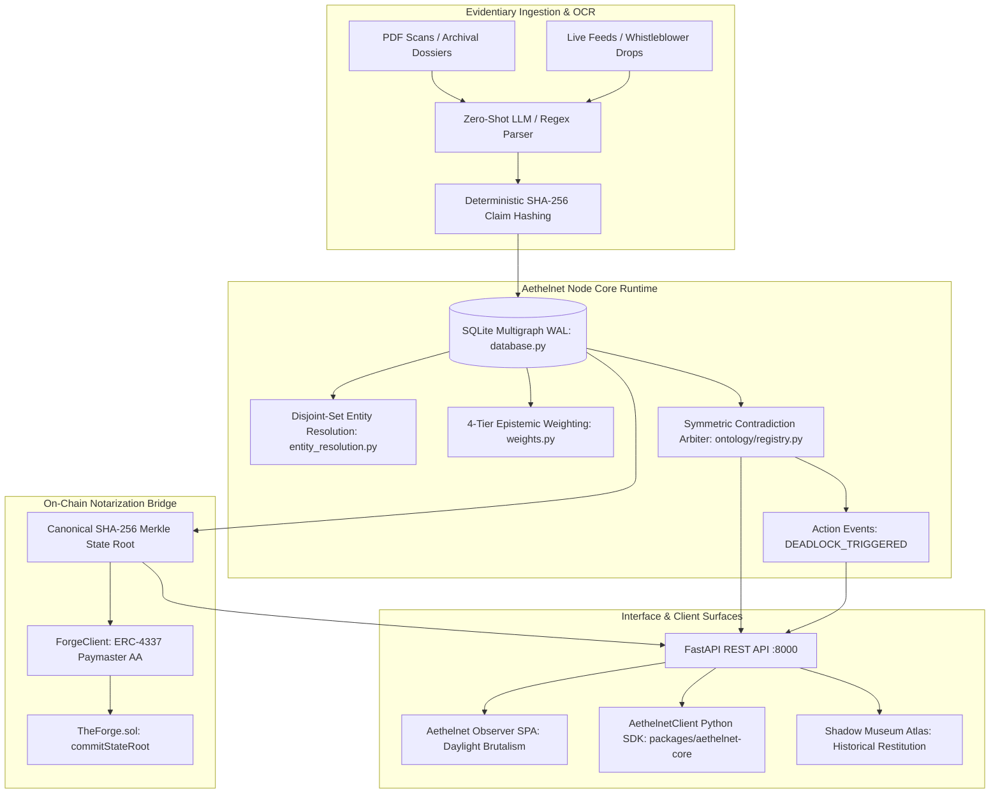

# Aethelnet Node: Production Evidentiary Ledger & Forensic REST Daemon

[](https://fastapi.tiangolo.com)
[](LICENSE)
[](https://aethelburg.network)
[](https://aethelburg.network)
[](aethelnet_node/database.py)

**Aethelnet Node** is the production multigraph daemon and evidentiary reconciliation engine for the Aethelnet network. Operating continuously on `server-141` (`https://aethelburg.network`), it manages partitioned multigraph databases, evaluates institutional credibility with a 4-tier epistemic weighting engine, clusters duplicate entities via disjoint-set forests, detects structural contradictions, and notarizes canonical SHA-256 state roots on-chain via ERC-4337 Account Abstraction.

---

## Architecture Overview



---

## Core Engine Components

### 1. 4-Tier Epistemic Weighting Engine (`weights.py`)

Every assertion edge $(u, v)$ carries a computed evidentiary weight $W \in [0.0, 1.0]$ based on institutional tier, verbatim completeness, and logarithmic multi-source corroboration:

$$ W(e) = \min\left(1.0, \; \text{BaseTier} \times \text{Completeness} \times \left(1.0 + 0.12 \times \log_2(N)\right)\right) $$

* **Tier 1 — Primary Archive (`0.95`)**: Official federal records, Bundesarchiv, historical military registers, peer-reviewed provenance catalogs (*Atlas der Abwesenheit*).
* **Tier 2 — Official Institutional (`0.75`)**: Museum inventory logs, acquisition registries, deeds of gift.
* **Tier 3 — Secondary / Press (`0.50`)**: Investigative journalism, scholarly monographs, museum guides.
* **Tier 4 — Unverified Statement (`0.30`)**: Corporate press releases, oral statements, uncorroborated assertions.
* **Verbatim Completeness Score**: Verbatim quotation ($\ge 50$ chars = `1.0`), concise quotation (`0.85`), fragment (`0.70`), unquoted statement (`0.60`).
* **Multi-Source Corroboration**: Logarithmic reinforcement for independently documented claims ($N$ distinct sources).

### 2. Contradiction Arbiter & ActionEvents (`ontology/registry.py`)

Evaluates competing claims between symmetric entity pairs $(A, B)$ under domain contradiction rules (e.g. `raubte` $\leftrightarrow$ `schenkte` or `confirms_balance` $\leftrightarrow$ `denies_account`):

* **Decisive Lead ($\Delta W \ge 0.15$)**: The higher-weight institutional source decisively overrides the lower-tier claim. Emits `DEADLOCK_RESOLVED_DECISIVE`.
* **Moderate Lead ($0.04 \le \Delta W < 0.15$)**: Clear evidence priority, subject to counter-discovery.
* **Deadlock ($\Delta W < 0.04$)**: Competing claims hold identical credibility; triggers `DEADLOCK_TRIGGERED` ActionEvents requiring human investigator arbitration.

### 3. Disjoint-Set Entity Resolution (`entity_resolution.py`)

Performs high-precision alias clustering across noisy historical and corporate corpora:
* **Honorific Stripping**: Normalizes military titles and honorifics (`Hauptmann`, `Major`, `von`, `Dr.`).
* **Inventory Harmonization**: Maps variations cleanly (`Inv.-Nr. B13897` $\leftrightarrow$ `B13897`, `III C 20681` $\leftrightarrow$ `C 20681`).
* **Strict Numerical Guardrail**: Prevents catastrophic merging of digit-differentiated catalog numbers (`015989` $\neq$ `015995`).
* **Atomic Consolidation**: Re-routes hundreds of incident edges to the canonical primary entity in a single SQLite transaction.

### 4. Canonical State Root & On-Chain Notarization (`forge_client.py`)

Computes a deterministic Merkle-style state root over all sorted nodes and edges:

$$ \text{StateRoot} = \text{SHA256}\left( \text{app\_id} \;\|\; \bigoplus_{n \in V} \text{Hash}(n) \;\|\; \bigoplus_{e \in E} \text{Hash}(e) \right) $$

The state root is notarized to `TheForge.sol` on EVM networks using `AethelnetPaymaster.sol` (ERC-4337 Account Abstraction) for gasless transaction sponsorship.

---

## Production REST API Reference

The node serves a high-performance REST API on port `8000` (proxied via `https://aethelburg.network/api`):

| Endpoint | Method | Description |
|---|:---:|---|
| `/api/ontology/apps` | `GET` | List all active cases, schemas, and entity counts. |
| `/api/ontology/apps` | `POST` | Register a new custom domain ontology and investigation. |
| `/api/ontology/apps/{app_id}` | `DELETE` | Safely remove a case and prune its graph edges. |
| `/api/ontology/multigraph/{app_id}` | `GET` | Retrieve graph nodes, edges, weights, and active conflicts. |
| `/api/ontology/multigraph/{app_id}/conflicts` | `GET` | Fetch all contested claims and mathematical verdicts. |
| `/api/ontology/multigraph/{app_id}/dedup_candidates` | `GET` | Scan for potential duplicate entities and alias variants. |
| `/api/ontology/multigraph/{app_id}/dedup_batch_execute` | `POST` | Execute atomic node consolidation with `dry_run` support. |
| `/api/ontology/multigraph/{app_id}/weights_recalculate` | `POST` | Recompute whole-case edge weights and resolution verdicts. |
| `/api/ontology/multigraph/edge` | `POST` | Commit a single verified claim with deterministic ID & evidence. |
| `/api/ontology/ingest/text` | `POST` | Idempotent zero-shot document extraction with ActionEvents. |
| `/api/ontology/multigraph/{app_id}/state_root` | `GET` | Compute canonical off-chain SHA-256 state root. |
| `/api/ontology/multigraph/{app_id}/notarize` | `POST` | Commit state root on-chain to `TheForge.sol` via Paymaster AA. |
| `/api/ontology/multigraph/{app_id}/notarization` | `GET` | Query on-chain notarization snapshot, timestamp & notary. |

### cURL Examples

```bash
# 1. Fetch case conflicts and verdicts
curl -s "https://aethelburg.network/api/ontology/multigraph/project_echo/conflicts" | jq .

# 2. Query canonical SHA-256 state root
curl -s "https://aethelburg.network/api/ontology/multigraph/project_echo/state_root" | jq .

# 3. Insert an evidentiary claim
curl -X POST "https://aethelburg.network/api/ontology/multigraph/edge" \
  -H "Content-Type: application/json" \
  -d '{
    "app_id": "project_echo",
    "source": "Gouvernement_Kamerun",
    "target": "Museum_Berlin",
    "relation_type": "raubte",
    "evidence_quote": "Requirierungsbefehl No. 402 vom 14. August 1902.",
    "source_doc_id": "Bundesarchiv_R1001_3289"
  }'
```

---

## Deployment & Operation

### Local Development

```bash
cd packages/aethelnet-node
pip install -r requirements.txt

# Start FastAPI server on port 8000
python3 -m uvicorn aethelnet_node.main:app --host 0.0.0.0 --port 8000 --reload
```

Swagger API documentation is available at `http://localhost:8000/docs`.

### Agent Identities (one token per agent)

Every agent (Gemini, Claude, an MCP client, a human script) gets its own token. Writes are attributed to the
agent that made them (`created_by` / `updated_by` on nodes, edges and claims, plus an audit log), which is the
basis for provenance and reputation.

```bash
python -m aethelnet_node.agents add gemini --description "Gemini in the maintainer's editor"   # prints the token once
python -m aethelnet_node.agents list
python -m aethelnet_node.agents rotate gemini    # new token, old one stops working
python -m aethelnet_node.agents revoke gemini
```

Only SHA-256 hashes are stored, in `agents.json` next to the database (git-ignored; `AETHELNET_AGENTS_FILE`
overrides the location). Agents send `Authorization: Bearer <token>`; MCP bridges use `AETHELNET_AUTH_TOKEN`
from their environment, so each agent's MCP config gets its own token.
`GET /api/agents/whoami` shows which agent a token belongs to; `GET /api/agents` lists agents with the number of
nodes and claims they created and how many of their claims are contested. The legacy `AETHELNET_AUTH_TOKEN`
still works and is attributed to `operator`.

### Associative Recall for Agents (MCP or HTTP)

When an agent is stuck it describes what it is trying to do and gets back the most relevant concepts, the concepts
agents needed together with them, and the claims attached to each (evidence, author, whether contested).

- **Retrieval:** BM25 over node texts + MiniLM meaning (reciprocal-rank fusion); without `sentence-transformers`
  only BM25. Archived and quarantined nodes are excluded.
- **Association:** Personalized PageRank (teleport 0.5) from the top hits over *used together* edges. Nodes become
  used together when one agent writes or links them, or marks them useful, within the same task:
  the `X-Aethelnet-Task` header (shared across agents, e.g. an issue number) or, without it, the agent's session
  (30 min gap). Daemon writes and recall results themselves don't count.
- Method and evidence: `aethelnet-core/research/recall_benchmark`.

```bash
# HTTP
curl -s "http://localhost:8000/api/lgnn/recall?q=how+do+I+reset+the+mixer&k=5" | jq .
curl -s -X POST http://localhost:8000/api/lgnn/recall/feedback -H "Authorization: Bearer $TOKEN" \
     -H "X-Aethelnet-Task: issue-42" -d '{"node_ids": ["Mixer_Reset", "Mixer_Firmware"]}'
```

**MCP:** point your MCP client at the stdio bridge with the agent's own token:

```json
{"command": "python", "args": ["-m", "aethelnet_node.mcp.mcp_stdio_server"],
 "env": {"AETHELNET_API_URL": "http://127.0.0.1:8000/api/lgnn", "AETHELNET_AUTH_TOKEN": "<this agent's token>"}}
```

The bridge talks to `GET /api/lgnn/mcp/tools` and `POST /api/lgnn/mcp/tools/call`. Over HTTP only safe tools are
exposed: `lgnn_topological_recovery`, `lgnn_mark_useful`, `lgnn_read_node_content`, `lgnn_query_graph`. Shell, local
file and network tools need a sandbox first.

### Production Daemon (Systemd on `server-141`)

The production node runs as a hardened systemd daemon on Oracle Cloud (`server-141`):

```bash
# Check service health
sudo systemctl status aethelnet-node

# View live WAL ingestion logs
journalctl -u aethelnet-node -f -n 50
```

*License: GNU Affero General Public License v3.0 (AGPL-3.0)*
