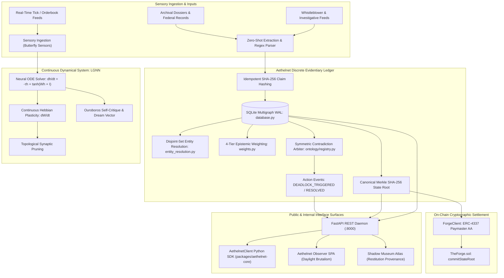

# Aethelnet Node: Architectural Specification & Technical Reference

[](https://aethelburg.network)
[](../LICENSE)
[](https://fastapi.tiangolo.com)
[](../aethelnet_node/database.py)
[](https://aethelburg.network)

---

## 1. Executive Summary & Dual Architecture

**Aethelnet Node** is a hybrid decentralized intelligence daemon combining two complementary computational paradigms:

1. **Continuous-Time Dynamical System (LGNN)**:
   A non-Euclidean manifold governed by non-linear Ordinary Differential Equations (ODEs) and Hebbian plasticity, modeling continuous sensory flow, concept decay, and autonomous cognitive drift.
2. **Deterministic Evidentiary Ledger (Multigraph)**:
   A partitioned, transactionally safe multigraph database powered by SQLite WAL, evaluating institutional credibility via a 4-tier epistemic weighting engine, resolving entity aliases via disjoint-set forests, arbiter-mediated contradiction resolution, and cryptographic state-root notarization to Ethereum Virtual Machine (EVM) contracts via ERC-4337 Account Abstraction.



---

## 2. Evidentiary Ingestion & Deterministic Hashing Pipeline

Every assertion ingested into an investigation case must be verifiable, deterministic, and idempotent.

### 2.1 Idempotent Claim Hash
To guarantee deduplication and prevent re-ingestion noise across concurrent spidering runs, claim IDs are computed deterministically:

$$\text{edge\_id} = \text{SHA256}\left(\text{app\_id} \;\|\; \text{source} \;\|\; \text{target} \;\|\; \text{relation\_type} \;\|\; \text{source\_doc\_id}\right)$$

If an identical claim is submitted multiple times, the transaction executes an `INSERT OR REPLACE` (or updates existing metadata without creating orphaned edge duplicates).

### 2.2 Ingestion Workflow (`ingest_llm.py` & `main.py`)
1. **Raw Document Intake**: Text or structured JSON is received via `POST /api/ontology/ingest/text`.
2. **Entity & Relation Extraction**: Entities and predicates are extracted using schema-constrained zero-shot prompts or rule-based tokenizers.
3. **Epistemic Authority Scoring**: The source document is matched against institutional authority tiers to assign an initial weight $W \in [0.0, 1.0]$.
4. **Graph Commit**: Nodes and multigraph edges are written atomically to `lgnn_multigraph_edges`.
5. **Dissonance Sweep**: The contradiction arbiter runs across affected node pairs. If a contradiction is detected or resolved, an `ActionEvent` payload is dispatched.

---

## 3. High-Concurrency Storage Layer (`database.py`)

Aethelnet Node utilizes a hardened SQLite database (`lgnn.db`) configured for high write concurrency and zero data corruption:

* **WAL Mode (Write-Ahead Logging)**: Readers never block writers, and writers never block readers.
* **Synchronous = NORMAL**: Balances durability with write throughput on SSD-backed hosts (`server-141`).
* **Busy Timeout = 30,000 ms**: Prevents `database is locked` errors during burst ingestions.
* **PostgreSQL Bridge**: Includes `PostgresCursorWrapper` and `PostgresConnectionWrapper` for enterprise clustering.

### 3.1 Core Schema Topography

```sql
-- Partitioned Multigraph Edges
CREATE TABLE IF NOT EXISTS lgnn_multigraph_edges (
    edge_id TEXT PRIMARY KEY,
    app_id TEXT DEFAULT 'general',
    source TEXT NOT NULL,
    target TEXT NOT NULL,
    relation_type TEXT NOT NULL,
    weight REAL DEFAULT 1.0,
    timestamp TEXT DEFAULT '',
    evidence_quote TEXT DEFAULT '',
    source_doc_id TEXT DEFAULT '',
    is_contested INTEGER DEFAULT 0,
    conflict_notes TEXT DEFAULT '',
    created_at TIMESTAMP DEFAULT CURRENT_TIMESTAMP,
    FOREIGN KEY (source) REFERENCES lgnn_nodes(id) ON DELETE CASCADE,
    FOREIGN KEY (target) REFERENCES lgnn_nodes(id) ON DELETE CASCADE
);

-- Indices for high-frequency queries
CREATE INDEX IF NOT EXISTS idx_multi_edges_app ON lgnn_multigraph_edges(app_id);
CREATE INDEX IF NOT EXISTS idx_multi_edges_src_tgt ON lgnn_multigraph_edges(source, target);
CREATE INDEX IF NOT EXISTS idx_multi_edges_relation ON lgnn_multigraph_edges(relation_type);
CREATE INDEX IF NOT EXISTS idx_multi_edges_contested ON lgnn_multigraph_edges(is_contested);
```

---

## 4. 4-Tier Epistemic Weighting Engine (`weights.py`)

A core innovation of Aethelnet is replacing naive "majority voting" with epistemic institutional weighting. Every claim edge $e$ receives a mathematical credibility score $W(e) \in [0.0, 1.0]$:

$$W(e) = \min\left(1.0, \; \text{BaseTier} \times \text{Completeness} \times \left(1.0 + 0.12 \times \log_2(N)\right)\right)$$

### 4.1 Authority Tiers

| Tier | Category | Base Weight | Examples |
|:---:|---|:---:|---|
| **1** | **Primary Archive / Official Record** | `0.95` | Bundesarchiv, military requisitions, official land registries, *Atlas der Abwesenheit* |
| **2** | **Institutional Inventory** | `0.75` | Museum catalog registries, deeds of gift, formal accession logs, verified export certificates |
| **3** | **Secondary Scholarship / Press** | `0.50` | Peer-reviewed historical monographs, investigative press dossiers, third-party scholarly essays |
| **4** | **Unverified Statement / Press Release**| `0.30` | Corporate self-audits, unilateral press statements, anecdotal oral statements |

### 4.2 Verbatim Completeness Multipliers
* **Extensive Verbatim Quote ($\ge 50$ chars)**: `1.00`
* **Concise Verbatim Quote ($20 - 49$ chars)**: `0.85`
* **Fragmentary Quote ($1 - 19$ chars)**: `0.70`
* **Unquoted Paraphrase**: `0.60`

### 4.3 Logarithmic Multi-Source Corroboration
When $N$ independent, distinct archival documents attest to the identical semantic relation $(u, v, r)$, the confidence score increases logarithmically by $+12\%$ per doubling of independent sources, capped at $1.00$.

---

## 5. Symmetric Contradiction Arbiter (`ontology/registry.py`)

Aethelnet continuously evaluates competing claims between symmetric entity pairs $(A, B)$ governed by domain contradiction rules.

### 5.1 Mutual Exclusion Semantics
For an investigation schema, conflicting relations are explicitly defined (e.g., `raubte` vs. `schenkte`, or `certifies_clean` vs. `denies_violations`). When edges with opposing relations connect the same entities, a dispute is opened:

$$\Delta W = |W_{\text{claim}_1} - W_{\text{claim}_2}|$$

### 5.2 Resolution Thresholds
* **Decisive Lead ($\Delta W \ge 0.15$)**:
  The higher-tier evidentiary source decisively overrides the lower-tier claim. The winning edge retains full weight; the contested edge is flagged with `is_contested = 1` and marked as mathematically overridden.
  *Event Emitted*: `DEADLOCK_RESOLVED_DECISIVE`
* **Moderate Lead ($0.04 \le \Delta W < 0.15$)**:
  Clear provisional evidence lead. Marked for investigator review, but prioritizes the dominant claim in downstream queries.
* **Epistemic Deadlock ($\Delta W < 0.04$)**:
  Both competing claims originate from sources of equivalent institutional credibility with no corroboration asymmetry. The system refuses to pick an arbitrary winner, flagging both edges as contested.
  *Event Emitted*: `DEADLOCK_TRIGGERED`

---

## 6. Disjoint-Set Entity Resolution (`entity_resolution.py`)

Historical archives and whistleblower dossiers frequently contain noisy, fragmented, or honorific-laden references to identical physical entities.

### 6.1 Algorithmic Pipeline
1. **Honorific & Title Stripping**:
   Normalizes strings by removing historical military and aristocratic titles (`Hauptmann`, `Major`, `Oberst`, `von`, `Dr.`, `Freiherr`).
2. **Catalog / Inventory Harmonization**:
   Strips punctuation and whitespace variations across museum inventory identifiers (`Inv.-Nr. B13897` $\leftrightarrow$ `B13897`, `III C 20681` $\leftrightarrow$ `C 20681`).
3. **Numerical Guardrail**:
   Strict invariant: If two entity labels contain differing digit sequences (e.g., `Catalog_015989` vs. `Catalog_015995`), **merging is strictly forbidden**, regardless of lexical string similarity.
4. **Disjoint-Set Forest (Union-Find)**:
   Partitions candidate clusters into equivalence sets using path compression and union-by-rank.
5. **Atomic SQLite Consolidation**:
   In a single transaction, inbound and outbound edges from all alias nodes are re-routed to the canonical root node, redundant duplicate nodes are pruned, and whole-graph conflict metrics are recalculated.

---

## 7. Cryptographic Authenticated State Root & On-Chain Notarization (`forge_client.py`)

Aethelnet guarantees evidentiary immutability through cryptographic notarization.

### 7.1 Canonical SHA-256 State Root
For any investigation `app_id`, a deterministic Merkle-style root hash is computed across all sorted, active entities and edges:

$$\text{StateRoot} = \text{SHA256}\left(\text{app\_id} \;\|\; \bigoplus_{n \in V} \text{Hash}(n) \;\|\; \bigoplus_{e \in E} \text{Hash}(e)\right)$$

Any modification, deletion, or injection of an evidentiary assertion permanently alters the state root.

### 7.2 ERC-4337 Account Abstraction Notarization
The node interacts with `TheForge.sol` smart contracts on EVM networks via `forge_client.py`:
* **Gasless Sponsorship**: Transactions are submitted via `AethelnetPaymaster.sol` using ERC-4337 UserOperations, eliminating the need for local private keys to hold native gas tokens.
* **On-Chain Attestation**: Records the state root, timestamp, block number, and notary identity on-chain for zero-trust third-party verification.

---

## 8. Continuous-Time LGNN & Dynamical Physics Engine

Alongside the discrete evidentiary ledger, Aethelnet Node retains its continuous neural ODE engine:

### 8.1 Continuous State Evolution
$$\frac{dh_i(t)}{dt} = -\tau_i h_i(t) + \tanh\left(\sum_{j \in \mathcal{N}(i)} W_{ij}(t) h_j(t) + I_i(t)\right)$$

* $\tau_i$: Concept decay rate (relaxation time).
* $W_{ij}(t)$: Synaptic coupling matrix.
* $I_i(t)$: Sensory injection from asynchronous spiders or market volatility sensors.

### 8.2 Hebbian Synaptic Plasticity & Pruning
$$\frac{dW_{ij}(t)}{dt} = \eta \cdot (h_i(t) \cdot h_j(t)) - \gamma \cdot W_{ij}(t)$$

Co-activated concepts organically form synaptic bridges. Connections whose weights decay below the topological threshold are automatically pruned, preserving bounded sparsity.

---

## 9. Production Operations on `server-141`

The canonical Aethelnet Node operates on Oracle Cloud Infrastructure (`server-141`):

### 9.1 Systemd Service Unit (`aethelnet-node.service`)
```ini
[Unit]
Description=Aethelnet Node Production Daemon
After=network.target

[Service]
Type=simple
User=ubuntu
WorkingDirectory=/opt/auratic-systems-prime/packages/aethelnet-node
Environment=PYTHONPATH=/opt/auratic-systems-prime/packages/aethelnet-node
Environment=DB_PROVIDER=sqlite
ExecStart=/usr/bin/python3 -m uvicorn aethelnet_node.main:app --host 0.0.0.0 --port 8000
Restart=always
RestartSec=5
StandardOutput=journal
StandardError=journal

[Install]
WantedBy=multi-user.target
```

### 9.2 Health & Diagnostic Commands
```bash
# Verify daemon status
systemctl status aethelnet-node

# Stream production logs
journalctl -u aethelnet-node -f -n 100

# Probe REST API health
curl -s http://localhost:8000/docs | grep -i "swagger"
```

---

*License: GNU Affero General Public License v3.0 (AGPL-3.0)*
