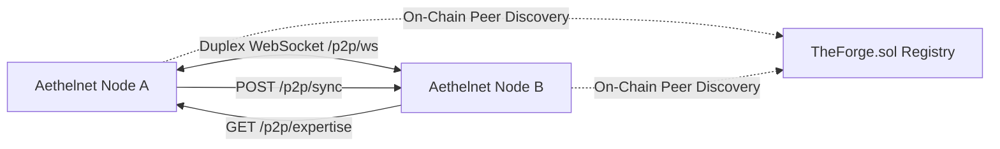

# Aethelnet P2P Synapse & Topological Gossip Protocol

[](p2p.py)
[](p2p.py)
[](forge_client.py)

The **Aethelnet P2P Protocol** connects distributed LGNN nodes into a decentralized cognitive mesh without requiring traditional Proof-of-Work or synchronous block mining. Instead, nodes engage in **Topological Gossip** and **Real-Time Resonance Propagation** over duplex WebSockets.

---

## 1. Network Topography & Dynamic Discovery

Peers discover each other through a dual-mechanism fallback:

1. **Static Bootstrapping**: Seed addresses defined via the `AETHELNET_PEERS` environment variable (e.g. `node1.aethelburg.network:8000,node2.aethelburg.network:8000`).
2. **On-Chain Smart Contract Registry**: Nodes query `TheForge.sol` on EVM networks via `forge_client.py` to retrieve verified, active peer endpoints registered by authorized network operators.



---

## 2. Real-Time Resonance Synapse (`/p2p/ws`)

Nodes maintain persistent, low-latency WebSocket connections to active peers (`ws://<peer>/p2p/ws`).

### 2.1 Sub-50ms Resonance Wave Broadcast
When a node's local ODE integration experiences a significant activation spike or phase shift in concept node $i$, it immediately broadcasts a `resonance_wave` payload:

```json
{
  "type": "resonance_wave",
  "node": "artifact_b13897",
  "state": 0.8421
}
```

Receiving peers inject this state update into their local ODE differential equations as an external perturbation $I_i(t)$, triggering local Hebbian resonance without requiring whole-graph transmission.

---

## 3. Asynchronous Graph Synchronization (`POST /p2p/sync`)

In addition to real-time activation waves, nodes periodically exchange full sub-topologies to synchronize evidentiary schemas and newly discovered entities.

```json
{
  "peer_id": "lgnn_node_server141",
  "nodes": [
    {
      "id": "Gouvernement_Kamerun",
      "text_content": "Colonial administrative body 1884-1916",
      "confidence": 0.95,
      "mean_activation": 0.72,
      "is_grounded": 1
    }
  ],
  "edges": [
    {
      "edge_id": "e8f0a2c...",
      "source": "Gouvernement_Kamerun",
      "target": "Museum_Berlin",
      "relation_type": "raubte",
      "weight": 0.95,
      "evidence_quote": "Requirierungsbefehl No. 402."
    }
  ]
}
```

### 3.1 The Mathematical Immune System
Foreign nodes are not blindly merged into the host's graph:
1. **Source Tagging**: All imported foreign nodes are tagged with `source_tag="p2p_<peer_id>"`.
2. **Confidence Attenuation**: Foreign confidence values are scaled by an epistemic trust coefficient $\kappa \in (0, 1]$.
3. **Contradiction Arbitration**: If an incoming edge directly contradicts an existing local edge (e.g. `schenkte` vs. `raubte`), the 4-tier epistemic weighting engine arbitrates the dispute. The local node will reject or flag the foreign claim if the local source holds higher authority.

---

## 4. Expertise Vector Extraction (`GET /p2p/expertise`)

Nodes can query a peer's specialized knowledge without downloading the entire database:

* **Endpoint**: `GET /p2p/expertise`
* **Response**: Top 10 most confident, ungrounded concept nodes developed through local compute and spidering cycles:

```json
{
  "domain": "general_expertise",
  "nodes": [
    {
      "id": "Bali_Nyonga_Requisitions",
      "confidence": 0.98,
      "plateau_factor": 0.02
    },
    {
      "id": "Puttkamer_Decree_1902",
      "confidence": 0.94,
      "plateau_factor": 0.05
    }
  ]
}
```

This allows specialized nodes (e.g. archival specialists, financial order-flow sensors) to share distilled conceptual vectors across the network.

---

## 5. Health & Diagnostic Probing (`GET /p2p/ping`)

To verify peer liveness and protocol compatibility:

```bash
curl -s http://localhost:8000/p2p/ping
```

```json
{
  "status": "alive",
  "peer_id": "lgnn_node_server141",
  "version": "1.0.0"
}
```

---

*License: GNU Affero General Public License v3.0 (AGPL-3.0)*
